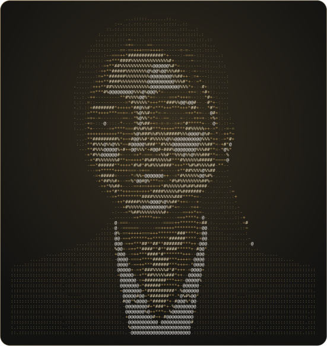

<div align="center">

<table border="0" cellspacing="0" cellpadding="10">
<tr>
<td valign="top"></td>
<td valign="top"></td>
</tr>
</table>

</div>

---

<div align="center">


<a href="https://github.com/YOUR-GITHUB-USERNAME">
  
</a>

<br/>

[](#)
[](#)
[](#)

<br/>

[](https://YOUR-PORTFOLIO-URL)
[](https://www.linkedin.com/in/YOUR-LINKEDIN-ID)
[](mailto:your-email@gmail.com)
[](https://github.com/YOUR-GITHUB-USERNAME)

</div>

---

## 👩‍💻 About Me

```yaml
name: "Khushi Kumari"
role: "MCA Student & Web Developer"
education:
  - "MCA (pursuing)"
  - "BCA (completed)"
location: "Dehradun, Uttarakhand, India"
focus:
  - "Web development with HTML, CSS, JavaScript, PHP & Laravel"
  - "Databases with SQL & MySQL"
  - "Cloud computing & data analytics"
```

I'm an MCA student passionate about web development, cloud computing and data analytics. I'm continuously learning new technologies and improving my skills, and I like turning what I learn into real projects — from a cake-ordering site to a hotel website and a registration system.

My goal is to keep sharpening my technical skills and build a successful career in the IT field.

**🎯 Open To:** Projects, internships and professional opportunities in web development.

---

## 🛠️ Tech Stack

**Frontend**

  

**Backend**

 

**Database**


---

## 🚀 Featured Projects

| # | Project | What it does | Stack |
|---|---|---|---|
| 01 | **Creamer Cake Website** | A cake ordering website where users can view cakes, add products to cart and place orders. | HTML · CSS · PHP · Laravel · MySQL |
| 02 | **Hotel Management Website** | A hotel website for displaying rooms, services and booking information. | HTML · CSS · JavaScript |
| 03 | **Student Registration System** | A web-based student registration form for collecting student information. | HTML · CSS · PHP · MySQL |
| 04 | **Personal Portfolio** | My personal portfolio showcasing skills, projects, certificates and contact details. | HTML · CSS · JavaScript |

---

## 📜 Certifications

[](#)
[](#)
[](#)
[](#)

---

## 🎯 Current Focus

```yaml
learning:
  - "Laravel & PHP web application development"
  - "SQL and database design"
  - "Cloud computing fundamentals"
  - "Data analytics"

building:
  - "Real-world web projects with a clean, responsive UI"

open_to:
  - "Web development projects"
  - "Internships and professional opportunities"
```

---

## 📊 GitHub Analytics

<div align="center">


</div>

---

## 📬 Connect With Me

<div align="center">

[](mailto:your-email@gmail.com)
[](https://www.linkedin.com/in/YOUR-LINKEDIN-ID)
[](https://github.com/YOUR-GITHUB-USERNAME)
[](https://YOUR-PORTFOLIO-URL)

</div>

---

<div align="center">

*"Good software is quiet. It does its job, looks considered, and respects the person using it."*


</div>
